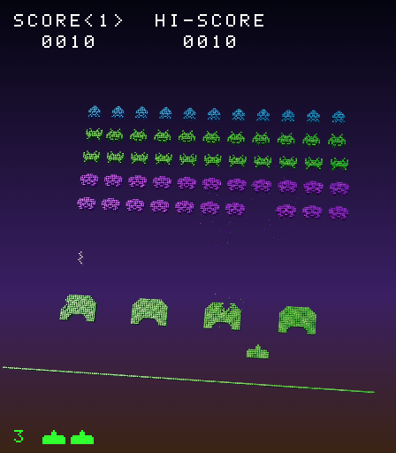

# Space Invaders 2.5D

Remaster 2.5D di _Space Invaders_ (Taito, 1978): le regole, i suoni e perfino il disegno sono quelli del [remake classico](../space-invaders/), importati senza modificarne una riga; cambia solo l'aspetto. Ogni pixel diventa un cubetto metallico, la visuale gira seguendo il cannone, gli invasori colpiti si sbriciolano in particelle e gli scudi perdono detriti.



## Come si gioca

| Tasto                | Azione                               |
| -------------------- | ------------------------------------ |
| **C** o **5**        | Inserisce una moneta e inizia        |
| Frecce o **A**/**D** | Muove il cannone, e con lui la vista |
| **Spazio**           | Spara                                |
| **M**                | Toglie e rimette l'audio             |
| **V**                | Oggetti monocromatici o a colori     |

Su smartphone e tablet compare lo stesso pannello del gioco classico, con il joystick virtuale. Se il sistema chiede di ridurre il movimento, la visuale gira molto meno.

Il record è **separato** da quello dello Space Invaders classico: le regole sono le stesse, ma sul sito sono due giochi diversi.

```bash
pnpm dev:space-invaders-25d   # dalla root del monorepo
pnpm build                    # output in games/space-invaders-25d/dist: index.html + game.css + game.js
```

## Da regolare

Tutti i valori dell'aspetto sono in [`src/tuning.config.ts`](src/tuning.config.ts): i colori dello sfondo (che il metallo riflette), l'angolo e la velocità della telecamera, l'inclinazione del campo, spessore e smussatura dei cubi, metallo e vernice, luci, esplosioni. Nessuno viene dall'originale, che non era in 3D: sono tutte scelte nostre.

## Modalità debug

È quella del gioco classico: la sezione `debug` del `tuning.config.ts` di [Space Invaders](../space-invaders/README.md#modalità-debug) vale anche qui, perché le regole sono le sue. Nelle anteprime delle pull request è accesa da sola.

## Come funziona

La [guida 20](../../docs/20-remaster-2-5d.md) spiega tutto passo per passo: gli import dal gioco originale, il contesto che registra il disegno, i voxel, i riflessi senza immagini, la telecamera, le particelle e il controllo che tiene leggeri i giochi classici.
